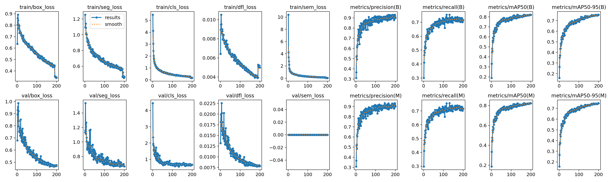

# Fruit Ripeness Assessment

Detects fruit in a photo, cuts each one out with a YOLO instance-segmentation
model, and grades its ripeness and surface blemishes using colour rules taken
from published grading standards and papers.

Supported fruit: **apple, banana, mango, orange, strawberry, tomato**.

Everything runs locally on a normal Windows PC. No GPU is needed to use the
app, and no image ever leaves your computer.

There are two front-ends that share the same pipeline:

- a **browser app** (Streamlit), the main one
- a **desktop window** (Tkinter) with the same features

---

## Contents

- [How it works](#how-it-works)
- [Quick start (Windows)](#quick-start-windows)
- [Manual install (any OS)](#manual-install-any-os)
- [Using the app](#using-the-app)
- [Ripeness rules](#ripeness-rules)
- [The detection model](#the-detection-model)
- [Training your own model](#training-your-own-model)
- [Command-line tools](#command-line-tools)
- [Project structure](#project-structure)
- [Data and privacy](#data-and-privacy)
- [Troubleshooting](#troubleshooting)
- [Limitations](#limitations)
- [References](#references)
- [License](#license)

---

## How it works

The pipeline is split into four modules. The numbers match the tabs in the app.

| Module | File | What it does |
| --- | --- | --- |
| 2.1 Pre-processing | `preprocessing.py` | Optional grey-world white balance, then CLAHE on the L channel of CIELAB. CLAHE is skipped when the image already has enough contrast. Nothing is resized or cropped, so masks line up with the original photo. |
| 2.2 Detection | `detection.py` | Runs YOLO26n-seg on the pre-processed image, removes overlapping duplicates and counts the fruit from the contour of each instance mask. Touching fruit are still counted separately because each one has its own mask. |
| 2.3 Ripeness | `ripeness.py`, `fruit_ripeness/` | Takes the **original** colours inside each mask (no enhancement) and measures the share of each colour class in HSV or CIELAB. A per-fruit rule turns those percentages into a ripeness index. |
| 2.4 Blemish | `blemish_detection.py` | k-means on the grey levels inside the fruit, keeps the darkest cluster, filters regions by size and rejects shadows by comparing their chroma with healthy skin. A fruit is marked *Defected* when the damaged area reaches 5% of its surface. |

The YOLO label can be wrong, so the app always lets you confirm or correct the
fruit type before the ripeness rule runs. A correction is also used in the
blemish report.

Results can be exported as masked crops with a `manifest.json` (2.2), or as a
PDF blemish report (2.4).

---

## Quick start (Windows)

1. **Download the project.** Click *Code -> Download ZIP* on GitHub and extract
   it, or clone it with git. Do not run anything from inside the ZIP.
2. **Double-click `SETUP.bat`.** It finds Python 3.10-3.12 (or downloads a
   private copy), creates a virtual environment, installs the packages and
   checks that the model loads. It needs internet and takes a few minutes.
3. **Double-click `RUN.bat`.** The app opens in your browser at
   <http://localhost:8501>. Keep the black window open while you use it, and
   close it to stop the app.

After the first setup, `RUN.bat` is all you need. If you run `RUN.bat` before
setup, it starts `SETUP.bat` for you.

If an NVIDIA graphics card is found, setup asks whether to install the GPU build
of PyTorch. The app works fine on the CPU, so answer **N** unless you plan to
train your own model. You can switch later:

```
SETUP.bat gpu
```

```
SETUP.bat cpu
```

Nothing is installed system-wide and no administrator rights are needed.
Everything goes into one folder, and deleting it uninstalls everything:

```
%LOCALAPPDATA%\FruitRipeness\venv\         virtual environment
%LOCALAPPDATA%\FruitRipeness\rt\           private Python (only if none was found)
%LOCALAPPDATA%\FruitRipeness\Ultralytics\  YOLO settings
```

`HOW_TO_RUN.txt` has the same steps in plain text.

---

## Manual install (any OS)

Python 3.10, 3.11 or 3.12.

```bash
python -m venv .venv
```

```bash
source .venv/bin/activate        # Windows: .venv\Scripts\activate
```

On Windows, install the CPU build of PyTorch first. It is about 200 MB instead
of 2.5 GB. Skip this on Linux and macOS.

```bash
pip install torch==2.11.0+cpu torchvision==0.26.0+cpu --index-url https://download.pytorch.org/whl/cpu
```

```bash
pip install -r requirements.txt
```

Start the browser app:

```bash
streamlit run streamlit_app.py
```

Or the desktop window:

```bash
python fruit_pipeline_gui.py
```

---

## Using the app

### Browser app

1. Choose **Upload image** or **Camera**. A sample photo is included in
   `samples/fruitplate.jpeg`.
2. Click **Run pipeline**. You get three panels (original, pre-processed and
   segmented), the fruit count, and a table with the class, confidence and
   area of every detection. **Inspect instance** zooms in on one fruit.
3. Under **Confirm fruit type**, pick a detected fruit. Click
   **Continue with ...** to accept the YOLO label, or choose the right fruit and
   click **Analyze as ...**. **Assess ALL detected fruits** runs every
   detection with its YOLO label.
4. The ripeness result shows the index, the stage, the colour percentages, the
   rule that was applied, and the colour masks drawn over the fruit.
5. Click **Detect blemishes on all fruits** for the defect check. Each fruit
   gets a Good / Defected verdict with its diagnostic images, a text report you
   can download, and **Export report as PDF** for all fruit at once.
6. **Export masked crops for ripeness** saves each fruit with its background
   removed into `pipeline_output/<timestamp>/` and offers it as a ZIP.

The sidebar has every tunable parameter, one tab per module: CLAHE strength,
confidence threshold, the model weights file, the HSV ranges and boundaries for
each fruit, and the blemish settings. Changes apply on the next run, and each
tab has a reset button.

The **Train** tab retrains the model. See
[Training your own model](#training-your-own-model).

### Desktop window

From a terminal in the project folder:

```
RUN.bat desktop
```

The buttons along the top follow the same order: **Load Image** or
**Capture Camera**, **Run Pipeline**, **Run Ripeness** (asks you to confirm the
fruit type one by one), **Run Blemish** (one dialog for all fruit),
**Blemish PDF**, **Export for Ripeness** and **Train Model**. The parameter tabs
are on the right. Tick **Auto re-run** to see parameter changes immediately.
The **App** tab sets the camera index if the wrong camera opens.

---

## Ripeness rules

The rules come from published papers and from grading standards of FAMA
(Malaysia's Federal Agricultural Marketing Authority) and the USDA; see
[References](#references). Each rule only looks at pixels inside the YOLO mask.
The exact thresholds are constants at the top of each file in
`fruit_ripeness/`, and all of them can be changed from the app.

| Fruit | Colour measurement | Result |
| --- | --- | --- |
| Apple | Red hue 0-15 or 175-179, yellow hue 20-25 (OpenCV HSV) | Index 1-5 from red coverage: <30, 30-50, 50-60, 60-80, >=80% |
| Banana | Brown is detected first, then yellow (brown pixels excluded) | Index 7 if brown >=20%, or the peel is fully developed with >1% brown spots. Otherwise Index 1-6 from yellow coverage: <=1, <30, 30-50, 50-80, 80-95, >=95% |
| Mango | Yellow H 15-30, S 135-255, V 80-255 | Stage 1-4 from yellow coverage: <=10, <=40, <=70, >70% |
| Orange | Citrus Colour Index per pixel, CCI = 1000 a* / (L* b*); CCI >= 0 counts as yellow/orange | Index 1-5 from yellow/orange coverage: <20, 20-50, 50-70, 70-90, >=90% |
| Strawberry | Red and dark-red HSV ranges | Index 3 if red >50%, Index 4 if dark red >=90%. Below 50% red it is Index 1 (<10% red) or Index 2. The <10% rule is not part of the FAMA standard and can be switched off |
| Tomato | Green, turning, pink and red HSV ranges | Index 1/2, 3, 3/4, 4 from colour-break and red/orange coverage. Above 90% red, the median L* of the red pixels separates Index 5 from Index 6 (threshold 40.7) |

When a photo sits exactly on a boundary that the standard does not define (for
example exactly 50% red on a strawberry), the result says so instead of
guessing.

---

## The detection model

Six classes: `apple`, `banana`, `mango`, `orange`, `strawberry`, `tomato`.
The base model is Ultralytics YOLO26n-seg (`yolo26n-seg.pt`).

| Weights | Training data | Epochs | Mask mAP50 | Mask mAP50-95 |
| --- | --- | ---: | ---: | ---: |
| `runs/segment/Fruit_Project/segmentation_run/weights/best.pt` (default) | labelled fruit plus background images with no fruit | 200 | 0.823 | 0.750 |
| `runs/segment/Fruit_Project/segmentation_run-no-false/weights/best.pt` | labelled fruit only | 50 | 0.938 | 0.840 |
| `runs/segment/Fruit_Project/segmentation_run_50ep/weights/best.pt` | earlier 50-epoch version | 50 | - | - |

The scores are on each run's own validation split, and the two splits are
different, so the numbers cannot be compared directly. The default model was
trained with empty background images so that it raises fewer false alarms. The
`no-false` model finds more fruit in busy scenes but also detects fruit where
there is none more often. Switch between them in the **2.2 Detect** tab, or
change `MODEL_PATH` in `detection.py`.

Each run folder also has the training curves, confusion matrices and
validation predictions, for example:



---

## Training your own model

The training images are not included in this repository. To retrain, put your
own data in a `data/` folder in the project root:

```
data/
  fruit_merged.json
  images/
    img_0001.jpg
    ...
```

`fruit_merged.json` is a COCO-style annotation file with polygon segmentation.
Every image goes in `images`, and every fruit outline in `annotations` with a
`category_id` from 0 to 5:

| id | 0 | 1 | 2 | 3 | 4 | 5 |
| --- | --- | --- | --- | --- | --- | --- |
| class | apple | banana | mango | orange | strawberry | tomato |

Images with no annotations are used as background (negative) images.

Then train from the **Train** tab, or:

```bash
python training.py --negatives 1
```

| Option | Default | Meaning |
| --- | --- | --- |
| `--negatives 0/1` | 1 | include background images; the run is saved as `segmentation_run` or `segmentation_run-no-false` |
| `--epochs` | 200 | maximum number of epochs |
| `--patience` | 50 | stop after this many epochs without improvement |
| `--batch` | 8 | batch size |
| `--imgsz` | 640 | training image size |
| `--workers` | 2 | data-loader workers |
| `--device` | auto | `0` for the first GPU, `cpu` to force the CPU |

`dataset/` is rebuilt from `data/` on every run with a seeded 80/20 split, so
the same data always gives the same split. Training **overwrites** the run
folder, including its `best.pt`. When it finishes, the app switches to the new
weights.

Training works on the CPU but is slow. For anything beyond a quick test, use
an NVIDIA GPU and install the GPU build with `SETUP.bat gpu`.

---

## Command-line tools

Every module in `fruit_ripeness/` can grade a single fruit crop on its own and
save the colour masks:

```bash
python fruit_ripeness/banana_ripeness/banana_ripeness_yolo.py banana.jpg --mask banana_mask.png
```

Without `--mask`, every non-black pixel is treated as fruit, which suits the
background-removed crops written by **Export masked crops**. The masks are
saved to `fruit_ripeness/<fruit>_ripeness/<fruit>_full_test_debug/` unless
`--out` is given. The strawberry tool also takes `--supplementary-index1`.

The pre-processing step can be run on its own too:

```bash
python preprocessing.py input.jpg output.png
```

---

## Project structure

```
streamlit_app.py           browser app
fruit_pipeline_gui.py      desktop app (Tkinter)
gui/                       desktop panels and widgets
preprocessing.py           module 2.1
detection.py               module 2.2
ripeness.py                module 2.3, sends each fruit to its rule
fruit_ripeness/            one ripeness rule per fruit
blemish_detection.py       module 2.4
blemish_report.py          PDF report
params_spec.py             parameter definitions shared by both apps
training.py                dataset build and YOLO training
runs/segment/Fruit_Project/  trained weights and training results
yolo26n-seg.pt             base model for training
samples/                   example photo
SETUP.bat, RUN.bat         Windows installer and launcher
```

---

## Data and privacy

- Images are processed in memory on your own computer. Nothing is uploaded.
- The browser app listens on `localhost` only, so other devices on your
  network cannot open it.
- Streamlit usage statistics are turned off in `.streamlit/config.toml`, and
  `SETUP.bat` turns off Ultralytics analytics (`sync=False`).
- Files are only written when you ask for them: masked crops go to
  `pipeline_output/`, and PDFs and text reports are saved where you choose.

---

## Troubleshooting

Whatever the problem, run `SETUP.bat` again first. It is safe to re-run and it
checks every package at the end.

**"Windows protected your PC"** - the `.bat` files are not digitally signed.
Click *More info* -> *Run anyway*. You can open them in Notepad to see what they
do.

**"DLL load failed ... Application Control policy has blocked this file"** -
Windows Smart App Control blocked the private Python that setup downloaded.
Install Python 3.12 from <https://www.python.org/downloads/>, delete
`%LOCALAPPDATA%\FruitRipeness` and run `SETUP.bat` again.

**The browser does not open** - open the address shown in the black window
yourself. If port 8501 is taken, for example by another Streamlit app,
`RUN.bat` uses the next free port, such as 8502.

**"weights NOT found" in the sidebar** - the path in the **2.2 Detect** tab
does not point to a `.pt` file. Click *Reset 2.2*.

**No fruit detected** - lower the confidence in **2.2 Detect**, or try the
`segmentation_run-no-false` weights. Photos where the fruit fill only a tiny
part of the frame are hard for a nano-sized model.

**The camera does not open** - in the browser app, allow camera access when the
browser asks. In the desktop app, change the camera index in the **App** tab.

**Training fails with a CUDA error** - you have the CPU build of PyTorch. Run
`SETUP.bat gpu`, or set the device to `cpu`.

---

## Limitations

- The ripeness rules are colour rules. They cannot judge firmness, smell,
  sugar content or gloss, which some grading standards also use (for example
  FAMA separates tomato Index 1 and 2 by gloss, so they are reported together).
- Lighting changes colour. Photos under strong coloured light or heavy shadow
  can shift the result by a stage. White balance in module 2.1 helps in some
  cases.
- The apple rule follows Fuji references. Other cultivars, such as green
  apples, will be graded as unripe.
- Blemish detection looks for dark regions. Pale bruises and dark natural skin
  patterns can be missed or flagged, although the shadow test removes most
  false alarms.
- Only the six trained classes are detected. Other fruit may be reported as the
  closest class or missed.

---

## References

**Apple**

- Hu et al. (2021). Infield Apple Detection and Grading Based on
  Multi-Feature Fusion. *Horticulturae*, 7(9), 276. Used for the red and
  yellow hue ranges.
- KR101038935B1. Maturity judgment method of Fuji apple and aging judgment
  color chart of Fuji apple. Used for the red-coverage index boundaries.

**Banana**

- Mendoza, F. & Aguilera, J. M. (2004). Application of Image Analysis for
  Classification of Ripening Bananas. *Journal of Food Science*, 69(9),
  E471-E477. doi:10.1111/j.1365-2621.2004.tb09932.x. Used for the 7-stage
  scale and brown-spot area as a late-ripening feature. The 20% heavy-brown
  cut-off is this project's own choice within the range the paper reports.

**Mango**

- Palafox-Carlos et al. (2012), Ataulfo mango. Used for the yellow-surface
  stage boundaries (0-10, 11-40, 41-70, 71-100%).
- Marianito-Cuahuitic et al. (2026), Ataulfo mango segmentation. Used for the
  yellow HSV range.
- FAMA FS005-2000. Supports the green-to-yellow progression only.

**Orange**

- Citrus Colour Index for Valencia oranges, CCI = 1000 a* / (L* b*). Using
  CCI >= 0 as a per-pixel mask is this project's adaptation.

**Strawberry**

- Fukuda et al. (2025). Used for the red and dark-red HSV thresholds and the
  90% dark-red overripe rule.
- FAMA FS069:2013. Used for the 50% red boundary between Index 2 and 3.

**Tomato**

- Comparative Analysis of R-CNN and YOLOv8 Segmentation Features for Tomato
  Ripening Stage Classification and Quality Estimation. *Horticulturae*
  (2026). Used for the green, turning, pink and red HSV thresholds.
- FAMA FS006-2000, the USDA tomato colour classification (>90% red for full
  red) and the UC ANR colour table (bright red L* 41.8, dark red L* 39.6).

**Blemish**

- Siridhara et al. (2023). k-means segmentation with the darkest cluster
  taken as the defect candidate, filtered by area against a user-defined
  threshold.

---

## License

The source code in this repository is released under the Apache License 2.0.
See [LICENSE](LICENSE).

The detection model is built on [Ultralytics YOLO](https://github.com/ultralytics/ultralytics),
which, together with the YOLO26 base weights, is licensed under AGPL-3.0.
Check that license before you redistribute the trained weights or use them in
a commercial product.
